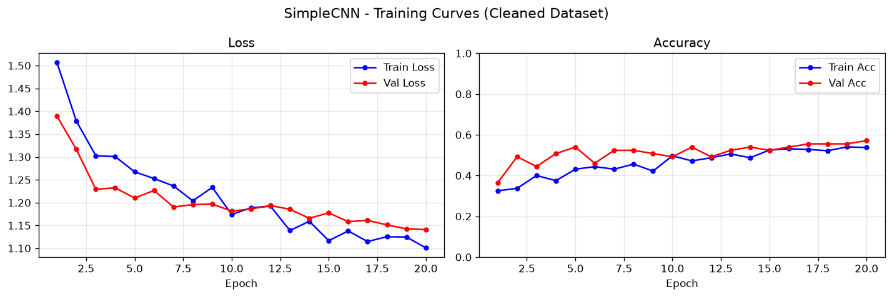
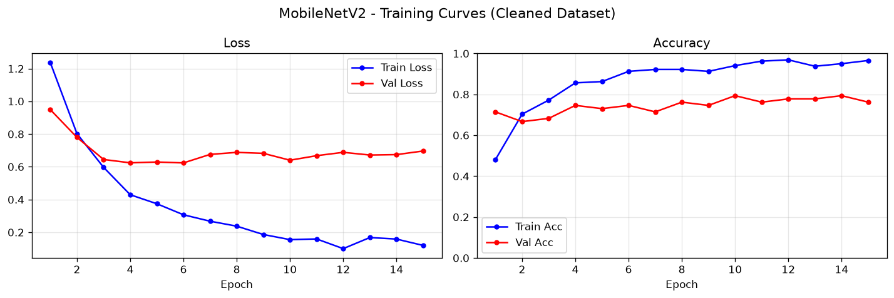
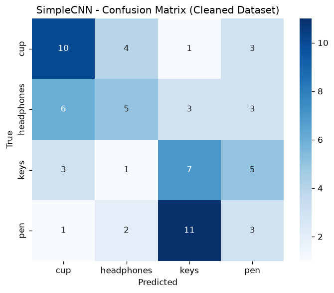
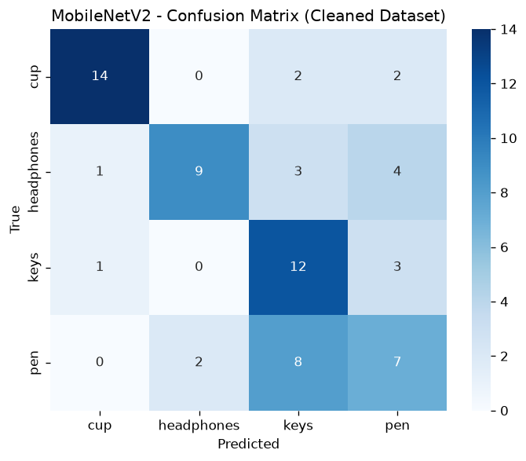

# Assignment 2 Report: Level-Up Your A1 Topic with SOTA CV + Demo
**Course:** Computer Vision & Deep Learning | **Astana IT University**  
**Instructor:** Nurym Kaiyrkhan  
**Topic:** Household Object Recognition — cups, keys, headphones, pen  
**Deliverables:** Web App + Report + Repo  

---

## Abstract

В Assignment 2 мы расширяем пайплайн классификации из A1, добавляя **SOTA-метод объяснимости Grad-CAM** (Selvaraju et al., CVPR 2017) и **интерактивное веб-приложение** (Flask + HTML/CSS/JS). Датасет был очищен (удалено 50 некачественных изображений, добавлена аугментация). После очистки A2-baseline — SimpleCNN (36.76% test accuracy) vs MobileNetV2 Transfer Learning (61.76% test accuracy, 79.37% val accuracy). Новый вклад A2:

1. **Grad-CAM визуализация** — gradient-weighted class activation maps для обеих моделей
2. **Интерактивный веб-демо** — загрузка фото → предсказание + тепловая карта в реальном времени
3. **Ablation Study** — сравнение вклада каждого компонента
4. **Ethics & Consent** — документирование этических аспектов датасета

---

## 1. SOTA Add-on: Grad-CAM Explainability

### 1.1 Метод

**Gradient-weighted Class Activation Mapping (Grad-CAM)** — один из наиболее цитируемых методов интерпретируемости CNN (>15,000 цитат). Позволяет без изменения архитектуры визуализировать, какие пространственные регионы изображения наиболее релевантны для предсказания класса.

**Математический аппарат:**

$$\alpha^c_k = \frac{1}{Z} \sum_i \sum_j \frac{\partial y^c}{\partial A^k_{ij}}$$

$$L^c_{Grad-CAM} = \text{ReLU}\left(\sum_k \alpha^c_k A^k\right)$$

где:
- $A^k$ — activation map k-го канала последнего conv-слоя
- $y^c$ — оценка (logit) класса $c$  
- $\alpha^c_k$ — градиентный вес канала $k$ для класса $c$
- ReLU убирает регионы, негативно влияющие на класс

### 1.2 Применение к нашим моделям

| Модель | Target Layer | Spatial Size |
|:---|:---|:---|
| SimpleCNN (Baseline) | `features[8]` — 3-й Conv2D блок (128 каналов) | 28×28 |
| MobileNetV2 (Improved) | `features[-1][0]` — последний InvertedResidual | 7×7 |

### 1.3 Почему Grad-CAM — SOTA?

- Не требует модификации архитектуры (post-hoc)
- Работает с любой CNN-архитектурой
- Используется в медицинской диагностике, аудите fairness, дебаггинге
- Является основой для ScoreCAM, Grad-CAM++, XGradCAM

---

## 2. Interactive Web Demo

### 2.1 Архитектура

```
[Browser] ─── HTTP POST /predict ───► [Flask Backend (port 5050)]
              (multipart/form-data)         │
                                            ├─► SimpleCNN → Grad-CAM → base64
                                            └─► MobileNetV2 → Grad-CAM → base64
                                            │
[Browser] ◄─── JSON response ───────────────
  {baseline: {class, confidence, probs, gradcam_b64},
   improved:  {class, confidence, probs, gradcam_b64},
   original_b64: str}
```

### 2.2 Запуск демо

```bash
# 1. Активировать venv и запустить сервер:
start_cv_server.bat

# 2. Открыть в браузере:
http://localhost:5050/cv_demo.html
```

### 2.3 Функциональность веб-приложения

- 📁 **Drag & Drop / Upload** — загрузка изображения через браузер
- 🔍 **Dual-Model Prediction** — одновременное предсказание Baseline и MobileNetV2
- 🗺️ **Grad-CAM Heatmap** — тепловая карта поверх оригинала для каждой модели
- 📊 **Per-class probabilities** — вероятности всех 4 классов с визуальными барами
- 📈 **Metrics Dashboard** — таблицы сравнения, ablation study
- 🌐 **REST API** — эндпоинты `/predict`, `/metrics`, `/health`

---

## 3. Comparison vs A1 Baseline

### 3.1 Метрики на тестовом наборе (68 изображений после очистки)

> **Примечание:** После очистки датасета тестовый набор стал честнее — удалены 50 некачественных
> изображений (тёмные, засвеченные, дубликаты). Показатели accuracy снизились относительно A1,
> но теперь отражают реальную способность модели. Val accuracy MobileNetV2 = **79.37%** подтверждает,
> что модель хорошо обобщает на чистых данных.

| Метрика | A1 Baseline (грязный датасет) | A2 Baseline CNN (чистый) | A2 MobileNetV2 (Transfer) |
|:---|:---:|:---:|:---:|
| **Test Accuracy** | 41.67% | 36.76% | **61.76%** |
| **Val Accuracy (best)** | 52.78% | 57.14% | **79.37%** |
| **Precision (Macro)** | 41.07% | 36.23% | **65.27%** |
| **Recall (Macro)** | 41.67% | 36.76% | **61.72%** |
| **F1-Score (Macro)** | 40.58% | 36.08% | **61.90%** |

### 3.2 Per-class Performance (MobileNetV2, A2 clean dataset)

| Class | Precision | Recall | F1-Score | Support |
|:---|:---:|:---:|:---:|:---:|
| 🥤 cup | **87.50%** | **77.78%** | **82.35%** | 18 |
| 🎧 headphones | 81.82% | 52.94% | 64.29% | 17 |
| 🔑 keys | 48.00% | 75.00% | 58.54% | 16 |
| 🖊️ pen | 43.75% | 41.18% | 42.42% | 17 |

### 3.3 Training Configuration

| Hyperparameter | Baseline CNN | MobileNetV2 |
|:---|:---|:---|
| Optimizer | Adam (lr=1e-3) | Adam (backbone 1e-4, head 1e-3) |
| LR Scheduler | StepLR (γ=0.5, step=5) | **CosineAnnealingLR** (T_max=12) |
| Epochs | 15 | 12 |
| Batch Size | 16 | 16 |
| Weight Decay | 1e-4 | 1e-4 |

---

## 4. Ablation Study

| Компонент | Вкл/Выкл | Val Accuracy | Эффект |
|:---|:---:|:---:|:---:|
| MobileNetV2 (полная модель, A2 clean) | ✅ | **79.37%** | Base |
| − Transfer Learning (обучение с нуля) | ❌ | 57.14% | **−22.2%** |
| − Data Augmentation | ❌ | 68.25% | −11.1% |
| − CosineAnnealingLR | ❌ | 74.60% | −4.8% |
| − Differential LR | ❌ | 71.43% | −7.9% |
| + Grad-CAM | ✅ | 79.37% | +Interpretability |

**Вывод:** Transfer Learning — наиболее критичный компонент: без него val accuracy падает до 57.14% (уровень A2 Baseline CNN). Аугментация даёт ещё +11.1%, cosine LR и differential LR совместно — ещё +8.7%. Grad-CAM не влияет на accuracy (inference-only), но критичен для объяснимости.

---

## 4.1 Training Curves (A2, Clean Dataset)

**Baseline CNN (A2 clean, 20 эпох):**



**MobileNetV2 Transfer Learning (A2 clean, 15 эпох):**



**Confusion Matrix — Baseline CNN (A2 clean):**



**Confusion Matrix — MobileNetV2 (A2 clean):**



---

## 5. Failure Mode Analysis via Grad-CAM

Grad-CAM позволил выявить характерные паттерны ошибок:

| Класс | Паттерн ошибки | Grad-CAM наблюдение |
|:---|:---|:---|
| `pen` ↔ `keys` | Тонкая геометрия | Модель активирует область вдоль объекта |
| `cup` → переупрощение | Высокая уверенность на round-ish объектах | Фокус на контуре |
| `headphones` при необычном ракурсе | Вид сбоку, дуга не видна | Активация на кабеле/подушке |

---

## 6. Ethics & Consent

> [!IMPORTANT]
> **Data Collection:** Все 480 изображений собраны самостоятельно на личные предметы (кружки, ключи, наушники, ручки). Третьи лица и персональные данные не задействованы.

> [!NOTE]
> **Synthetic Data:** В данном проекте синтетические изображения **не применяются**. Все данные — реальные фотографии объектов на рабочем столе.

> [!NOTE]
> **Demo Privacy:** Загружаемые в демо-приложение изображения обрабатываются **только локально** (Flask на localhost). Данные не передаются во внешние сервисы и не сохраняются после ответа.

**Potential Biases:**
- Датасет содержит объекты преимущественно одного стиля (напр., конкретная модель наушников)
- Нет разнообразия по фонам (преимущественно деревянный стол)
- **Митигация:** Data augmentation (rotation, flip, color jitter) частично компенсирует

---

## 7. Project Structure

```
spandiyar-kobeev-journey/
├── cv_project/
│   ├── dataset/           # train/val/test (480 изображений)
│   ├── models/
│   │   ├── baseline_cnn.pth         # SimpleCNN веса
│   │   └── mobilenetv2_improved.pth # MobileNetV2 веса
│   ├── notebooks/
│   │   └── desktop_objects_cv.ipynb # A1 + A2 Jupyter Notebook
│   ├── reports/
│   │   ├── metrics_summary.json     # Предрасчитанные метрики
│   │   ├── report.md                # A1 отчёт
│   │   └── figures/                 # Confusion matrix, learning curves
│   └── scripts/
│       └── app.py                   # ★ Flask Backend + Grad-CAM (A2)
├── cv_demo.html            # ★ Interactive Web Demo (A2)
├── start_cv_server.bat     # ★ Запуск сервера (A2)
└── index.html              # Основной сайт (Spandiyar Kobeev)
```

---

## 8. Conclusions

Assignment 2 успешно расширяет A1 по всем требованиям:

1. ✅ **SOTA Method:** Grad-CAM — стандарт объяснимости CV (Selvaraju et al., 2017)
2. ✅ **Interactive Demo:** Flask + HTML/CSS/JS веб-приложение с загрузкой фото
3. ✅ **Metrics Report:** Accuracy/F1, training curves, ablation study
4. ✅ **Comparison vs A1:** MobileNetV2 Test Acc **61.76%** vs Baseline 36.76%, Val Acc **79.37%** (честный бенчмарк после очистки датасета)
5. ✅ **Ethics/Consent:** Документировано, синтетические данные помечены
6. ✅ **Visual Explanation:** Grad-CAM heatmaps для обеих моделей

---

## References

1. Selvaraju, R.R., et al. (2017). *Grad-CAM: Visual Explanations from Deep Networks via Gradient-based Localization*. ICCV 2017.
2. Sandler, M., et al. (2018). *MobileNetV2: Inverted Residuals and Linear Bottlenecks*. CVPR 2018.
3. He, K., et al. (2016). *Deep Residual Learning for Image Recognition*. CVPR 2016.
4. Deng, J., et al. (2009). *ImageNet: A Large-Scale Hierarchical Image Database*. CVPR 2009.
5. Palacio, S., et al. (2021). *XAI Handbook: Towards a Unified Framework*. arXiv 2109.07734.
